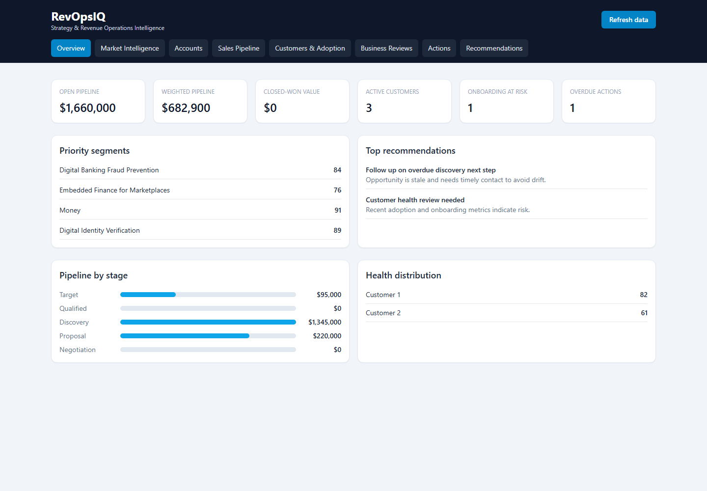
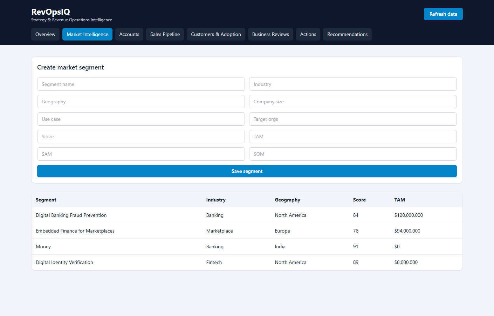

# RevOpsIQ

RevOpsIQ is a portfolio prototype for a fictional B2B SaaS company's strategy and revenue operations team. It brings market segments, target accounts, opportunities, customers, business reviews, actions, and recommendations into one data-backed application.

> **Demo only:** All records and market assumptions are synthetic and illustrative. They are not verified market research, customer data, or predictions. Do not enter real customer information or use this prototype as a production CRM.

The product direction comes from [`RevOpsIQ_Detailed_Project_Synopsis.pdf`](./RevOpsIQ_Detailed_Project_Synopsis.pdf). The current implementation is a working vertical slice, not the complete product described in that specification. Implemented functionality and known gaps are called out below.

## Screenshots

### Overview dashboard



### Market Intelligence



## Product workflow

The intended operating loop is:

**Understand the market → prioritise accounts → manage opportunities → onboard customers → monitor performance → review results → assign and track actions.**

The current app provides a connected data-backed starting point for this loop: segments can be associated with accounts, opportunities belong to accounts, and customer records can refer to an account and opportunity. Dashboard pipeline values and customer health summaries are read from the backend. Some transitions between stages of the intended workflow are still manual or not implemented.

## Current capabilities

| Area | Available now | Not yet complete |
|---|---|---|
| Overview | Database-backed pipeline and customer KPIs, priority segments, pipeline by stage, health summaries, and active recommendations. | Broader filtering, drill-downs, metric glossary, and more complete performance reporting. |
| Market Intelligence | List and create segments with industry, geography, use case, score, and TAM/SAM/SOM fields. Duplicate segment identities (name + industry + geography, case-insensitive and trimmed) are rejected with a validation message. | Segment editing/archive, evidence management, competitor comparison screens, score breakdowns, and sizing-methodology workflows. |
| Accounts | List and create accounts; records may be linked to a segment and owner. | Contacts UI, richer qualification workflows, edit/archive, import, and advanced search/filtering. |
| Sales Pipeline | List and create opportunities; display stage, value, probability, next step, and weighted value. | Opportunity editing and stage-history workflow, forecast filters, and automatic Closed Won conversion. |
| Customers & Adoption | List and create customers; view current health-score summaries. | Onboarding plan and milestone management, adoption observations, renewal workflows, and customer health history. |
| Business Reviews | List and create review records with period, owner, status, and summary. | KPI snapshots, decisions, finalisation, and historical review workflows. |
| Actions | List and create actions with owner, priority, due date, and status fields. | Full status lifecycle, completion notes, project tracking, and action-to-review workflows. |
| Recommendations | List and create recommendations; seeded demo recommendations are shown on the dashboard. | Accept/dismiss/snooze lifecycle, evidence review, deduplication rules, and conversion to an action. |
| Business metrics | Overview pipeline and customer summaries plus a basic metrics endpoint. | Full metric registry, target-versus-actual reporting, cost inputs, exports, and broader formula/test coverage. |

These are honest implementation boundaries, not claims that the remaining specification items are present. Authentication/RBAC, CSV import/export, database migrations, deployment configuration, and a comprehensive automated test suite are also not implemented yet.

## Technology and architecture

- **Frontend:** React, TypeScript, Vite, Tailwind CSS
- **Backend:** Python, FastAPI, Pydantic, SQLAlchemy
- **Local database:** SQLite
- **API documentation:** FastAPI OpenAPI / Swagger UI

The backend is a small modular-monolith prototype. Models, seed data, and API routes are currently concentrated in [`backend/app/main.py`](./backend/app/main.py); database engine and session configuration are in [`backend/app/database.py`](./backend/app/database.py). The frontend's API client and module views are currently in [`frontend/src/App.tsx`](./frontend/src/App.tsx).

### Data and persistence

- By default, the backend uses `sqlite:///./revopsiq.db`. Because the backend command below runs from `backend`, the database file is `backend/revopsiq.db`.
- On startup, SQLAlchemy creates missing tables and demo seed data is inserted only when the database has no users. This is not a migration system and does not reset an existing database.
- Set `DATABASE_URL` in the root `.env` to use another SQLAlchemy database URL. PostgreSQL is the intended future production database, but PostgreSQL configuration and migrations are not currently delivered or validated.
- All demo content is fictional; sample source URLs and market estimates are illustrative.
- Do not delete the SQLite database to resolve ordinary application issues: doing so loses locally entered data.

### Main API endpoints

| Method | Endpoint | Purpose |
|---|---|---|
| `GET` | `/api/health` | Backend health response |
| `GET` | `/api/overview` | Dashboard summary and KPI values |
| `GET`, `POST` | `/api/segments` | Market segment list and create |
| `GET`, `POST` | `/api/accounts` | Account list and create |
| `GET`, `POST` | `/api/opportunities` | Opportunity list and create |
| `GET`, `POST` | `/api/customers` | Customer list and create |
| `GET`, `POST` | `/api/reviews` | Business review list and create |
| `GET`, `POST` | `/api/actions` | Action list and create |
| `GET`, `POST` | `/api/recommendations` | Recommendation list and create |
| `GET` | `/api/metrics` | Basic market-size aggregate |
| `GET` | `/api/health-scores` | Customer health-score summaries |
| `GET` | `/api/audit` | Audit record list |

Interactive API documentation is available at `http://127.0.0.1:8001/docs` while the backend is running.

## Requirements

- Windows with PowerShell (the commands below assume the terminal starts at the repository root, next to this README)
- Python 3.11 recommended
- Node.js and npm compatible with the Vite version in `frontend/package.json`

Dependencies are pinned or specified in [`backend/requirements.txt`](./backend/requirements.txt) and [`frontend/package-lock.json`](./frontend/package-lock.json).

## Setup

Open a PowerShell terminal at the repository root and create the backend environment:

```powershell
py -3.11 -m venv .venv
.\.venv\Scripts\python.exe -m pip install -r backend\requirements.txt
Copy-Item .env.example .env
```

If `.env` already exists, keep it and edit only the values you need; do not overwrite local configuration. The example uses SQLite and permits the local frontend origin.

In a second terminal, install the frontend dependencies:

```powershell
Set-Location .\frontend
npm ci
```

## Run locally

Start each service in its own PowerShell terminal.

### 1. Backend — port 8001

```powershell
Set-Location .\backend
..\.venv\Scripts\python.exe -m uvicorn app.main:app --reload --host 127.0.0.1 --port 8001
```

Backend API: `http://127.0.0.1:8001` | Swagger UI: `http://127.0.0.1:8001/docs`

### 2. Frontend — port 5173

```powershell
Set-Location .\frontend
npm run dev
```

Frontend: `http://127.0.0.1:5173`

Vite is configured in [`frontend/vite.config.ts`](./frontend/vite.config.ts) to bind to `127.0.0.1:5173` with `strictPort: true`. If that port is occupied, Vite exits with a port-in-use error instead of silently using another port. The frontend API URL is configured in [`frontend/src/App.tsx`](./frontend/src/App.tsx) as `http://127.0.0.1:8001/api`.

Stop either development server with **Ctrl+C** in its terminal. Port 8000 may be used by another local project; RevOpsIQ's documented backend port is 8001.

## Environment configuration

The repository includes [`.env.example`](./.env.example). Copy it to `.env` for local overrides:

| Variable | Example | Description |
|---|---|---|
| `DATABASE_URL` | `sqlite:///./revopsiq.db` | SQLAlchemy connection string; relative SQLite paths are resolved from the backend working directory. |
| `APP_ENV` | `development` | Environment label. |
| `CORS_ORIGINS` | `http://127.0.0.1:5173` | Comma-separated allowed browser origins for the API. |
| `SECRET_KEY` | `replace-me` | Placeholder only; authentication/session security is not implemented. Never use this value as a production secret. |

The frontend currently targets the local RevOpsIQ API directly. Changing the backend host or port requires updating `API` in `frontend/src/App.tsx` and keeping `CORS_ORIGINS` in sync.

## Demo data and workflows

On an empty database, startup seeds fictional users, market segments, competitors, accounts, opportunities, customers, reviews, actions, and recommendations. The seed function exits when it finds existing users, so it will not automatically fill missing records in an existing database.

For a quick smoke check after starting the backend:

```powershell
Invoke-RestMethod 'http://127.0.0.1:8001/api/health'
Invoke-RestMethod 'http://127.0.0.1:8001/api/overview'
Invoke-RestMethod 'http://127.0.0.1:8001/api/segments'
```

Use the UI to inspect the dashboard, create a segment/account/opportunity/customer/review/action/recommendation, and refresh the page to confirm persisted records. Creating a segment with an existing name, industry, and geography returns HTTP `409 Conflict` and displays the validation message in Market Intelligence.

## Validation and tests

Build the frontend:

```powershell
Set-Location .\frontend
npm run build
```

Compile the backend Python modules:

```powershell
.\.venv\Scripts\python.exe -m compileall backend\app
```

The backend requirements include pytest, but a comprehensive backend test suite has not been added yet. Running `pytest` currently reports that no tests were collected. API smoke checks and the frontend production build have been used for basic validation; these do not replace automated tests.

## Known gaps and next steps

The original specification describes a broader product than the current prototype. High-value next phases include:

1. Split the backend into routers, schemas, services, and rules; add Alembic migrations.
2. Expand market research, competitor/evidence management, segment scoring, and account research.
3. Add opportunity editing and stage history, plus a tested Closed Won → customer workflow.
4. Implement onboarding plans, milestones, adoption observations, and explainable health history.
5. Add a metric registry, target/actual reporting, date and segment filters, and export workflows.
6. Complete reviews, KPI snapshots, decisions, project tracking, and action status/completion history.
7. Implement recommendation lifecycle actions and recommendation-to-action conversion.
8. Add authentication, backend-enforced role permissions, input validation coverage, and audit tests.
9. Add CSV import/export with row validation and error reporting, then document deployment only after it is configured and tested.

The project synopsis is the source of truth for intended behavior, acceptance criteria, guardrails, and the phased implementation plan. See [`docs/product-overview.md`](./docs/product-overview.md) for a brief product summary.
